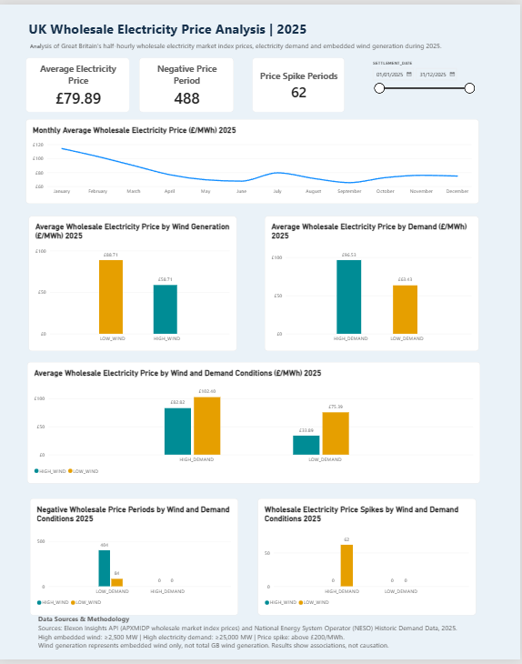

# UK Wholesale Electricity Price Analysis | 2025

## Project Overview

This project explores how Great Britain's wholesale electricity prices varied with electricity demand and embedded wind generation throughout 2025.

Using Snowflake SQL and Power BI, I analysed 17,520 half-hourly records to identify price trends, negative-price periods, price spikes, and differences in pricing under various wind and demand conditions.

## Tools and Technologies

- **Snowflake SQL:** Data validation, joining datasets, analysis and preparation of the final reporting view.
- **Power BI:** DAX measures, interactive visualisations and dashboard development.
- **Python:** Initial cleaning and preparation of electricity price data.

## Data Sources

- **Elexon Insights API:** APXMIDP short-term wholesale market index prices.
- **National Energy System Operator (NESO):** Historic Demand Data 2025, including electricity demand and embedded wind generation.

## Key Findings

- **Average wholesale electricity price:** £79.89/MWh.
- **Negative-price periods:** 488 half-hourly periods.
- **Price spikes:** 62 periods with prices exceeding £200/MWh.
- **Wind generation:** Average prices were £88.71/MWh under low embedded-wind conditions, compared with £58.71/MWh under high embedded-wind conditions.
- **Electricity demand:** Average prices were £96.53/MWh under high-demand conditions, compared with £63.43/MWh under low-demand conditions.
- **Combined conditions:** The highest average price (£102.40/MWh) occurred during high-demand, low-wind periods.
- **Negative prices:** Approximately 83% occurred during high-wind, low-demand conditions.
- **Price spikes:** All 62 occurred during high-demand, low-wind conditions.

## Dashboard

The interactive dashboard includes price trends, wind and demand comparisons, negative-price analysis, price-spike analysis and date filtering.

## Methodology

1. Prepared and validated the source datasets.
2. Loaded electricity price and NESO demand data into Snowflake.
3. Joined the datasets using settlement date and settlement period.
4. Used SQL to investigate correlations, price trends, negative prices and price spikes.
5. Created a Snowflake reporting view and imported it into Power BI.
6. Developed DAX measures and interactive visualisations.

The final dataset contains 17,520 records, including 11 records with missing price values, leaving 17,509 valid price observations.

## Definitions and Limitations

- High embedded wind: at least 2,500 MW.
- High electricity demand: at least 25,000 MW.
- Price spike: wholesale electricity price above £200/MWh.
- Wind generation refers to embedded wind, not total GB wind generation.
- The price series represents APXMIDP short-term market index prices, not day-ahead or imbalance settlement prices.
- The analysis identifies statistical associations and does not establish causation.

## Project Files

- `UK_Electricity_Price_Analysis_2025_Portfolio.sql` — Snowflake SQL analysis.
- `UK_Wholesale_Electricity_Price_Analysis_2025.pbix` — Power BI dashboard.
- `PowerBI_Dashboard.png` — Dashboard preview.
